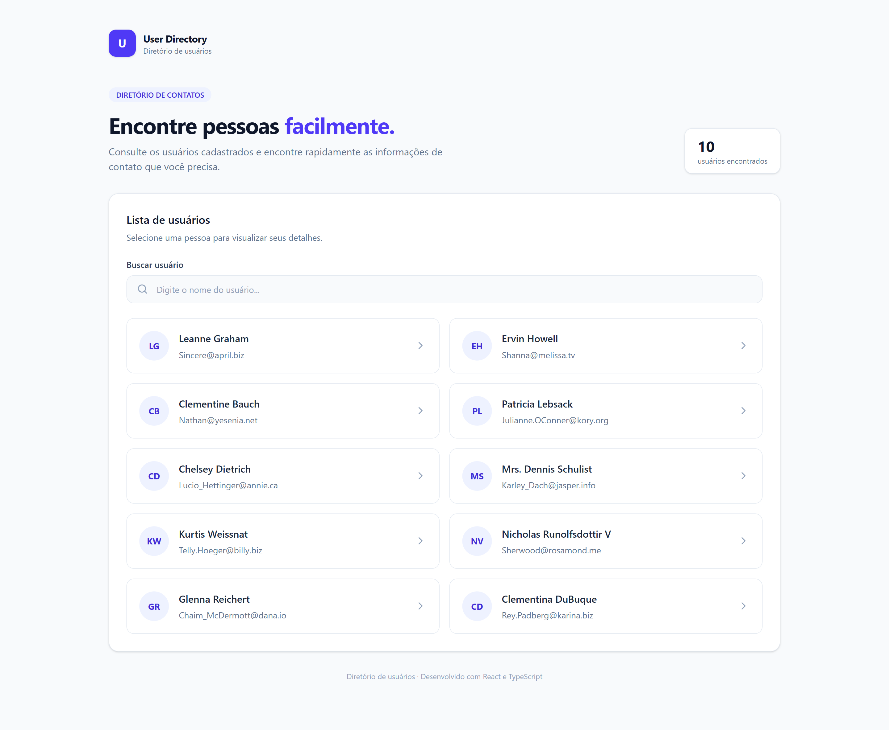
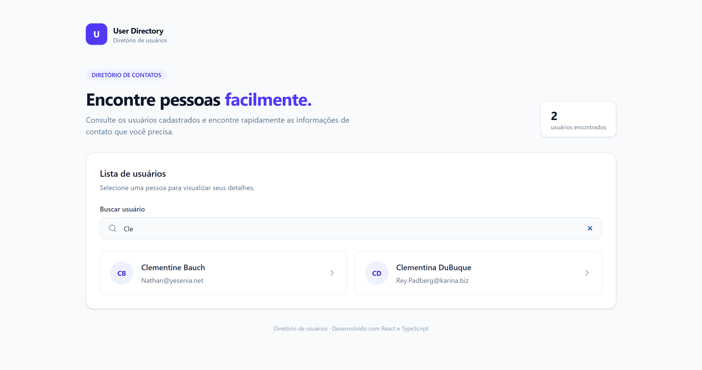
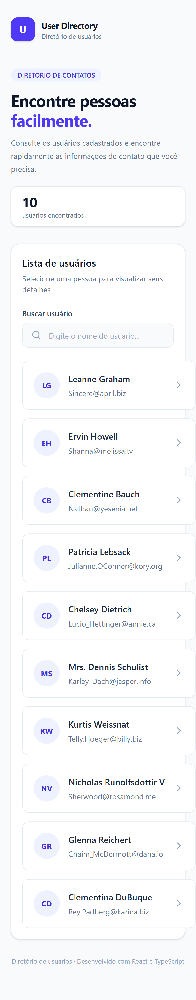

# User Directory

Aplicação desenvolvida como parte do desafio técnico para uma vaga de Desenvolvedor Front-End Júnior.

O **User Directory** consome a API pública [JSONPlaceholder](https://jsonplaceholder.typicode.com/) para exibir uma lista de usuários, permitindo pesquisar nomes e consultar informações detalhadas de cada pessoa.

**[Acessar demonstração](https://isabela-fernanda.github.io/Desafio-Tecnico-Desenvolvedor-Front-End-Junior/)**

## Funcionalidades

- Listagem de usuários com nome e e-mail.
- Busca de usuários pelo nome.
- Visualização dos detalhes de cada usuário em um modal.
- Exibição de nome completo, e-mail, telefone, empresa e cidade.
- Indicador visual durante o carregamento dos dados.
- Tratamento e exibição de erros durante a requisição.
- Fechamento do modal pelo botão, clique fora ou tecla `Escape`.
- Interface responsiva para diferentes tamanhos de tela.

## Tecnologias utilizadas

- **React** – construção da interface e gerenciamento de componentes.
- **TypeScript** – tipagem estática.
- **Vite** – ferramenta de desenvolvimento e build.
- **Tailwind CSS** – estilização da interface.
- **Vitest** – execução dos testes automatizados.
- **React Testing Library** – testes dos componentes e hooks.
- **jest-dom** – verificações adicionais dos elementos da interface.
- **user-event** – simulação de interações do usuário.
- **JSONPlaceholder** – API utilizada para obtenção dos dados.

## Como executar o projeto

### Pré-requisitos

- Node.js
- npm

### Instalação

Clone o repositório:

```bash
git clone https://github.com/Isabela-Fernanda/Desafio-Tecnico-Desenvolvedor-Front-End-Junior.git
```

Entre na pasta do projeto:

```bash
cd Desafio-Tecnico-Desenvolvedor-Front-End-Junior
```

Instale as dependências:

```bash
npm install
```

Inicie o servidor de desenvolvimento:

```bash
npm run dev
```

O Vite disponibilizará um endereço local no terminal para acessar a aplicação pelo navegador.

## Testes

Os testes automatizados foram desenvolvidos com Vitest e React Testing Library.

Para executar os testes em modo de observação:

```bash
npm run test
```

Para executar os testes uma única vez:

```bash
npm run test:run
```

### Cobertura dos testes

| Componente / Hook | Verificações |
|---|---|
| UserCard | Exibição de informações e clique |
| SearchBar | Valor do campo e alteração da busca |
| UserDetails | Exibição dos detalhes e fechamento do modal |
| useUsers | Estado inicial, carregamento e tratamento de erros |

Atualmente, o projeto possui **10 testes automatizados**, distribuídos em 4 arquivos de teste.

## Outros comandos

### Build de produção

```bash
npm run build
```

Gera a versão de produção da aplicação na pasta `dist`.

### Análise estática

```bash
npm run lint
```

Executa a análise estática do código com ESLint.

### Visualização da versão de produção

```bash
npm run preview
```

Inicia um servidor local para visualizar a versão gerada pelo build.

## API utilizada

Os dados dos usuários são obtidos através do endpoint:

[https://jsonplaceholder.typicode.com/users](https://jsonplaceholder.typicode.com/users)

## Capturas de tela

### Desktop






### Mobile



---

Desenvolvido como parte do desafio técnico para Desenvolvedor Front-End Júnior.